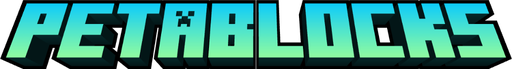

<p align="center">
  
</p>

# PETABLOCKS 3D Text

A blocky 3D text and banner maker for **PETABLOCKS: The Minecraft Network**. Use it to make titles and banners for modpacks, servers and social media in the PETABLOCKS style.

It is a fork of [EaseCation/cube-3d-text](https://github.com/EaseCation/cube-3d-text) (MIT licence), built with React and Three.js. The whole site is static, so it runs on Cloudflare Pages' free plan with nothing else to host.

## What's PETABLOCKS-specific

- **Brand material presets.** The first four presets in the Texture panel use the brand palette from [`petablocks-brand`](https://github.com/Petablocks/petablocks-brand):
  - **Primary:** Electric Cyan `#0FCDF8` to Mint Green `#8BFAA3`, with a deep teal extrusion and a black outline.
  - **Tagline:** Neon Magenta `#E040FB` to Network Purple `#A824FF`, with a Deep Nether Purple extrusion.
  - **Mint:** the primary gradient reversed, for secondary headings.
  - **Light:** neutral light text for dark banners.
- **Brand fonts.** Minecraft Ten, Chakra Petch Bold, Work Sans (SemiBold and Bold), Press Start 2P and Unifont ASCII are all SIL OFL fonts, and they're bundled in `public/fonts`. You can upload any other TTF from the font picker.
- **Banner export.** The **Banner** button exports PNGs at the sizes in the brand marketing guide. It fits the text into each size's safe area automatically:

  | Preset | Size | Safe area |
  | :--- | :--- | :--- |
  | Discord server banner | 960 × 540 | Centred, clear of the bottom 20% |
  | X / Twitter header | 1500 × 500 | 1200 × 400 centre box |
  | YouTube channel banner | 2560 × 1440 | 1232 × 338 centre box |
  | Minecraft server icon | 64 × 64 | Saved as `server-icon.png` |
  | Modpack banner | 1920 × 1080 | 1600 × 700 centre box |
  | Custom | any | 10% margin |

  Backgrounds are transparent, Deep Space `#0B0F19`, Panel `#111827`, black, or a dark brand glow.

## Making a banner

1. Type your text in each line's **Content** box. Add more with **Add Line**.
2. Pick a font in **Scene & Camera Settings**, and a preset under **Texture**.
3. Drag in the 3D view to set the camera angle you want.
4. Click **Banner**, choose a size and background, and click **Download PNG**.

**Export Project** (in the menu next to Screenshot) saves a JSON file. You can reopen it later with **Open Project**.

## Deploying to Cloudflare Pages

1. In the Cloudflare dashboard, go to **Workers & Pages**, then **Create**, then **Pages**, then **Connect to Git**, and pick `Petablocks/cube-3d-text`.
2. Use these build settings:

   | Setting | Value |
   | :--- | :--- |
   | Production branch | `main` |
   | Framework preset | None (or Vite) |
   | Build command | `yarn build` |
   | Build output directory | `dist` |
   | Root directory | *(leave empty)* |
   | Environment variable | `NODE_VERSION` = `22` (also pinned in `.node-version`) |

3. Click **Save and Deploy**. Every push to `main` then redeploys automatically, and each pull request gets its own preview URL.
4. Optionally, add a custom domain such as `3d.petablocks.com` under the project's **Custom domains** tab.

The build is about 3.3 MB across roughly 45 files, well inside the free plan's limits (25 MiB per file, 20,000 files, 500 builds a month).

## Development

```bash
yarn            # install dependencies
yarn dev        # start the dev server at http://localhost:5173
yarn lint       # ESLint
yarn test       # unit tests
yarn test:e2e   # Playwright browser tests
yarn build      # production build into dist/
yarn preview    # serve the production build locally
```

To add a built-in font, convert it and then register it in `src/utils/fonts.ts`:

```bash
yarn convert-font path/to/Font.ttf public/fonts/Font_Name.json
```

Only bundle fonts whose licence allows commercial use, such as SIL OFL fonts, and keep the licence file next to the font.

To add a material preset, put a JSON file in `public/materials/` and list its name in `public/materials/index.json`. The easiest way to make one is to design it in the app and use **Export Textures**.

## Credits and licence

Based on [Cube 3D Text](https://github.com/EaseCation/cube-3d-text) by EaseCation, under the MIT licence (see [LICENSE](./LICENSE)). The PETABLOCKS name, logos and colours belong to PETABLOCKS. Font licences are in `public/fonts/` and are shown in the app's font picker.
